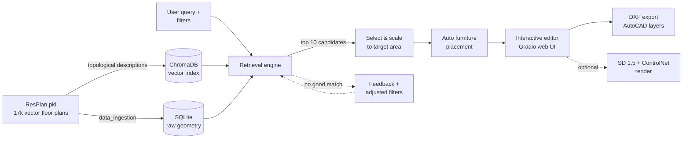

# FloorplanCopilot — "Cursor for Architects"

Describe the apartment you want in plain English, pick the best match from a database of real floor plans, resize it to your target area, furnish it in an interactive editor, and export a layered **DXF file that opens directly in AutoCAD**. Optionally, generate a photorealistic top-down or 3D-isometric render with Stable Diffusion + ControlNet.

<!-- TODO: add a short screen recording here, e.g. docs/demo.gif (search → select → furnish → export) -->

## Features

- **Natural-language floor plan search (RAG)** – every plan in the [ResPlan](https://github.com/m-agour/ResPlan) dataset is turned into a topological text description (rooms, adjacencies, entry flow, balconies, storage) and indexed in ChromaDB. Queries can be combined with structured filters (bedrooms / bathrooms / balconies).
- **Iterative refinement** – the top 10 candidates are shown side by side; if none fit, the user adds feedback and adjusts the filters for the next search.
- **Parametric scaling** – the selected plan is scaled to the requested area (sqm) while keeping its geometry consistent.
- **Automatic furniture layout** – room-aware placement of beds, sofas, dining tables, kitchen fixtures etc., seeded automatically and then editable.
- **Interactive web editor (Gradio)** – add, move and delete furniture icons on the plan, zoom, undo/clear.
- **CAD export** – walls, rooms, doors (with swing arcs), labels and furniture written to separate DXF layers with `ezdxf`.
- **AI rendering (optional)** – the edited plan is converted into segmentation + Canny control maps and rendered with Stable Diffusion 1.5 + Multi-ControlNet.
- **Engineering** – unit tests with pytest, structured logging, Ruff / MyPy / Bandit pre-commit hooks, a Docker image for Azure App Service and CI on GitHub Actions.

## How it works



## Tech stack

| Area | Tools |
|---|---|
| Retrieval | ChromaDB (local embeddings), SQLite, NetworkX (plan → room graph) |
| Geometry & CAD | Shapely, ezdxf, OpenCV, Matplotlib |
| Generative rendering | Hugging Face Diffusers, Stable Diffusion 1.5, ControlNet (seg + canny) |
| UI | Gradio (web), PySide6 (desktop editor in CLI mode) |
| Quality & delivery | pytest + pytest-cov, Ruff, MyPy, Bandit, pre-commit, Docker, GitHub Actions |

## Project structure

```
ResPlan_RAG/
├── Dockerfile                    # lean web image (no torch) for Azure App Service
├── resplan_dataset_files/        # put ResPlan.pkl here (not committed)
└── pipeline_code/
    ├── config.py                 # paths, env vars, render settings
    ├── main.py                   # entry point (web editor or CLI pipeline)
    ├── data_ingestion/           # builds the SQLite + ChromaDB databases
    ├── retrieval_engine/         # vector search, filters, scaling, CLI flow
    ├── dxf_exporting/            # furniture placement + DXF writer
    ├── gradio_GUI/               # web editor
    ├── snapshot_pipeline/        # control maps + diffusion render
    ├── static_analysis/          # Ruff / MyPy / Bandit config
    └── tests/                    # pytest unit tests
```

## Getting started

**Requirements:** Python 3.11. No API keys are needed – embeddings run locally.

```bash
git clone https://github.com/OfekZagury/FloorplanCopilot.git
cd FloorplanCopilot
python -m venv .venv
source .venv/bin/activate            # Windows: .venv\Scripts\activate
pip install -r ResPlan_RAG/pipeline_code/requirements.txt
cp .env.example .env                 # optional: change the defaults below
```

### 1. Download the dataset

Download `ResPlan.pkl` from the [ResPlan repository](https://github.com/m-agour/ResPlan) and place it at `ResPlan_RAG/resplan_dataset_files/ResPlan.pkl`.

### 2. Build the databases (one-time)

```bash
python -m ResPlan_RAG.pipeline_code.data_ingestion.data_ingestion
```

This creates `ResPlan_RAG/pipeline_code/databases/` with the SQLite store and the ChromaDB index.

### 3. Run

```bash
# Web editor (default) – opens on http://127.0.0.1:8001
python -m ResPlan_RAG.pipeline_code.main

# Terminal flow with the desktop (PySide6) editor
ENABLE_WEB_EDITOR=false python -m ResPlan_RAG.pipeline_code.main
```

### Docker

The image contains the lean runtime only (no torch / diffusers), so rendering is disabled. Build the databases first – they are copied into the image.

```bash
cd ResPlan_RAG
docker build -t floorplan-copilot .
docker run -p 8080:80 --env-file ../.env floorplan-copilot
```

## Configuration

| Variable | Default | Purpose |
|---|---|---|
| `ENABLE_WEB_EDITOR` | `true` | `true` = Gradio web app, `false` = terminal + desktop editor |
| `ENABLE_POST_DONE_RENDER` | `false` | Generate a Stable Diffusion render after export (needs torch + diffusers) |
| `GRADIO_HOST` / `GRADIO_PORT` | `127.0.0.1` / `8001` | Web server address |
| `RESPLAN_LOG_LEVEL` | `INFO` | Logging level |

## Tests and code quality

```bash
pip install -r ResPlan_RAG/pipeline_code/static_analysis/requirements-dev.txt
python -m pytest -c ResPlan_RAG/pipeline_code/tests/pytest.ini ResPlan_RAG/pipeline_code/tests
pre-commit run --all-files           # Ruff, MyPy, Bandit
```

The test suite runs automatically on every push via GitHub Actions.

## Credits

- Floor plan data: [ResPlan](https://github.com/m-agour/ResPlan) by Abouagour & Garyfallidis ([paper](https://arxiv.org/abs/2508.14006)), data licensed CC BY 4.0.
- `resplan_utils.py` is adapted from the ResPlan repository (MIT license).
